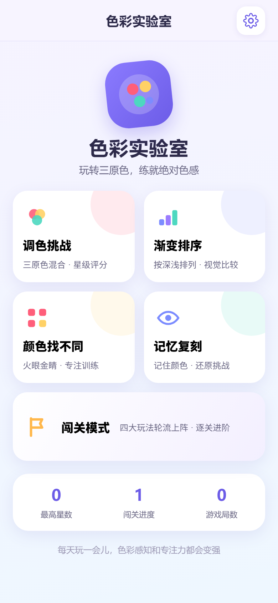
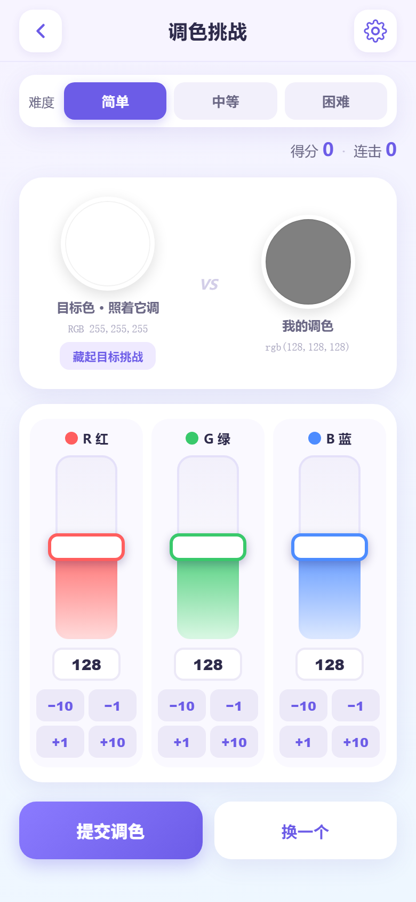
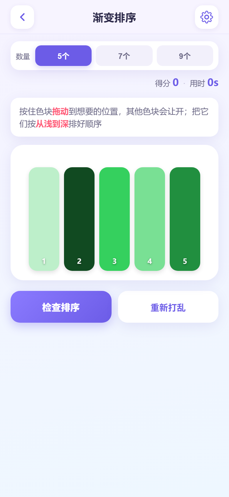
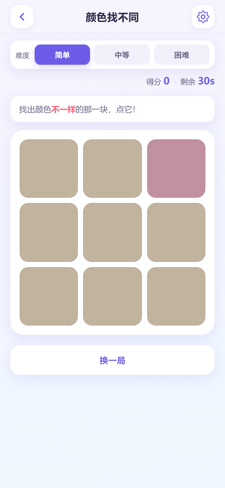
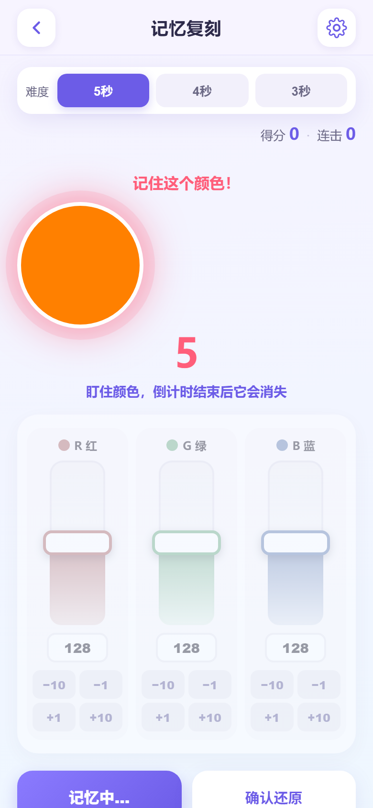
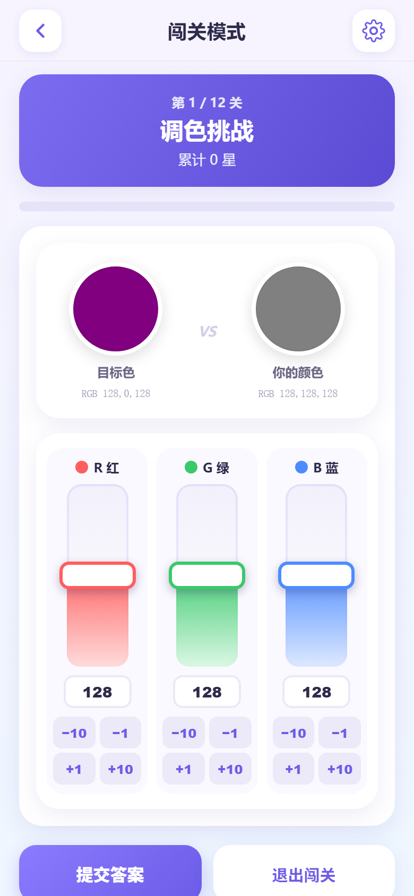
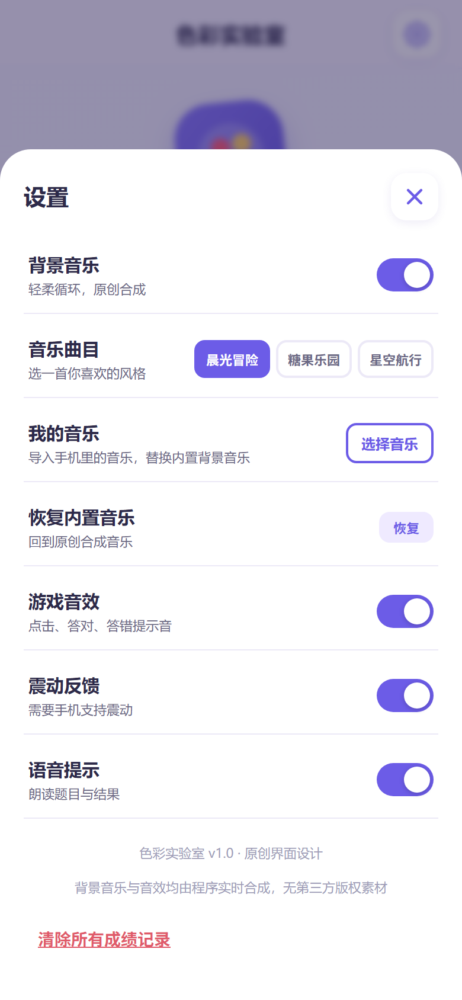

# 色彩实验室（Color Lab）

一款原创的儿童色彩感知训练应用，玩法灵感来自市面上的"色彩游戏机"玩具。界面、图标、音乐全部重新设计，不使用原产品的外观与素材。

应用提供两种形态：

- **安卓 APK**：可安装的原生应用，支持系统级震动反馈
- **单文件 HTML**：一个文件，手机或电脑浏览器直接打开即玩，无需服务器、无需联网

---

## 玩法一览

| 玩法 | 说明 |
|------|------|
| **调色挑战** | RGB 三原色竖向推杆（0–255），支持拖动、±1 / ±10 微调、长按连续调节；系统给出目标色，按 Lab 色差评 1–6 星 |
| **渐变排序** | 5 / 7 / 9 个色块，按住拖动，其他色块平滑让位；按从左到右"由浅到深"排列 |
| **颜色找不同** | 3×3 / 4×4 / 5×5 网格限时找异色；答错有红闪、扣分动画与强震动反馈 |
| **记忆复刻** | 目标色醒目展示后隐藏，用推杆凭记忆还原；展示时长可调 |
| **闯关模式** | 12 关，四大玩法轮换，难度递进，累计星数与闯关进度保存在本地 |

设置中可分别开关背景音乐、游戏音效、震动反馈和语音提示。背景音乐内置三首原创合成曲目（晨光冒险 / 糖果乐园 / 星空航行），也可以导入手机里的本地音乐替换。

---

## 功能截图

所有截图均为手机界面实拍（应用内截取）：

| 首页 | 调色挑战 |
|:---:|:---:|
|  |  |
| 五大玩法入口 | 目标色对照 + RGB 竖向推杆 |

| 渐变排序 | 颜色找不同 |
|:---:|:---:|
|  |  |
| 拖动色块，按由浅到深排列 | 限时找出颜色不一样的那一块 |

| 记忆复刻 | 闯关模式 |
|:---:|:---:|
|  |  |
| 颜色醒目展示，倒计时后还原 | 12 关，四大玩法轮换进阶 |

<details>
<summary>设置页面（音乐 / 音效 / 震动 / 语音）</summary>



</details>

---

## 快速开始

### 安卓手机（推荐）

下载仓库中的 `色彩实验室.apk`，传到手机后点击安装。若系统提示，请允许"安装未知来源应用"。

> 该 APK 为 debug 签名版本，自行安装使用没有问题；上架应用商店才需要正式签名。

### 电脑预览

双击打开 `色彩实验室-单文件版.html` 即可试玩，不需要安装任何软件。

### 手机浏览器（不装 APK 时）

把 `色彩实验室-单文件版.html` 通过微信、QQ、邮箱或数据线发到手机，选择"用浏览器打开"。所有功能都在这个文件里，断网也能玩。

> 注意：单文件 HTML 版的震动依赖浏览器支持，安卓 Chrome 可用，iPhone 的浏览器不支持网页震动。APK 版使用原生震动调用，不受此限制。

---

## 项目结构

```
.
├── index.html                  应用主页面
├── css/style.css               样式与动画
├── js/app.js                   玩法逻辑、评分与闯关
├── js/audio.js                 Web Audio 合成音乐、音效、震动封装
├── icon.svg / manifest.json / sw.js   PWA 配置
├── 色彩实验室-单文件版.html      所有代码内联的免服务器版本
├── 色彩实验室.apk                编译好的安卓安装包
├── www/                        Capacitor 使用的 Web 资源目录
├── android/                    Capacitor 生成的安卓原生工程
│   └── app/src/main/java/com/colorlab/game/NativeVibrator.java  原生震动插件
├── capacitor.config.json       Capacitor 配置（应用 ID：com.colorlab.game）
└── package.json
```

---

## 从源码重新构建 APK

### 环境要求

- JDK 17（Temurin 或其他发行版）
- Android SDK：`platform-tools`、`platforms;android-34`、`build-tools;34.0.0`
- Gradle 8.2.1
- Node.js 与 npm

### 构建步骤

```bash
npm install

# 把最新前端资源同步进 Capacitor 的 www 目录
cp index.html manifest.json icon.svg sw.js www/
cp -r css/. www/css/
cp -r js/. www/js/
cp node_modules/@capacitor/core/dist/capacitor.js www/

npx cap sync android

cd android
gradle assembleDebug
```

产物路径：`android/app/build/outputs/apk/debug/app-debug.apk`

构建时需设置 `JAVA_HOME` 和 `ANDROID_HOME`（或 `ANDROID_SDK_ROOT`）。本项目路径含中文，`android/gradle.properties` 中已加入 `android.overridePathCheck=true` 以通过路径检查。国内网络环境可在 `android/build.gradle` 中使用镜像仓库加速依赖下载。

---

## 原创与版权说明

- 界面采用原创"色彩实验室"主题，未模仿原玩具的外形与图标。
- 背景音乐与音效由 Web Audio API 实时合成，是本项目原创旋律，不含任何第三方音频文件，因此不存在音乐版权问题。
- 用户导入的本地音乐仅保存在用户设备本地，应用不上传、不分发。

---

## 数据与隐私

应用不联网、不收集任何用户信息。成绩、设置与闯关进度仅保存在设备本地（浏览器 localStorage）；清除浏览器数据或卸载应用后会被重置。
